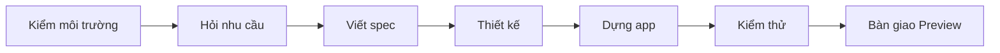

# Lark Base Site Builder

**Skill cho AI Agent dựng site/app trên Lark Base Database — từ một câu mô tả nhu cầu đến app chạy thật.**

Bạn chỉ cần nói "Tôi muốn làm app quản lý nghỉ phép cho công ty 50 người". Agent sẽ hỏi vài câu (có sẵn đáp án mặc
định), viết bản đặc tả (spec) 10 khối cho bạn duyệt, rồi dựng app đầy đủ: bảng dữ liệu, phân quyền, AI, thông báo,
giao diện. Cuối cùng agent tự kiểm thử và bàn giao link Preview.

Dùng được với **Claude Code · Codex · Google Antigravity · Gemini CLI · Cursor · GitHub Copilot · OpenCode ·
WorkBuddy** và các agent hỗ trợ chuẩn Agent Skills (`SKILL.md`).

> Tài liệu cộng đồng, không phải sản phẩm chính thức của Lark. Đối chiếu với base-database-cli 1.7.0 và SDK 0.4.2
> (xem `platform-baseline.json`).

## Mục lục

- [Skill làm được gì](#skill-làm-được-gì)
- [Chuẩn bị (làm một lần)](#chuẩn-bị-làm-một-lần)
- [Cài skill](#cài-skill)
- [Bắt đầu dùng](#bắt-đầu-dùng)
- [Cập nhật, gỡ cài đặt](#cập-nhật-gỡ-cài-đặt)
- [Bên trong có gì](#bên-trong-có-gì)
- [Tùy biến và đóng góp](#tùy-biến-và-đóng-góp)
- [Câu hỏi thường gặp](#câu-hỏi-thường-gặp)

## Skill làm được gì

| Bạn nói | Skill làm |
|---|---|
| "Làm app quản lý nghỉ phép cho công ty 50 người trên Lark Base." | **Dựng trọn gói**: hỏi nhu cầu → spec → dựng → kiểm thử → bàn giao link Preview |
| "Viết prompt dựng CRM bán hàng bằng base-database, tôi đưa cho agent khác." | **Chỉ viết spec**: ra file `app-spec.md` 10 khối, đã kiểm bằng `lint_spec` |
| "Nâng cấp app LMS ở link /baseapp/… thêm chứng chỉ PDF." | **Nâng cấp app có sẵn**: đọc app, đề xuất thay đổi, dựng và kiểm lại |
| "Rà soát spec này giúp tôi: app-spec.md." | **Rà soát**: chỉ ra chỗ thiếu, rủi ro với nền tảng, sửa thành bản tốt hơn |



Có sẵn **13 mẫu nghiệp vụ**: CRM★, LMS★, xếp ca có AI, nghỉ phép, tuyển dụng, ERP kho, trung tâm yêu cầu, đăng ký sự
kiện, giám sát sản xuất, kho tài sản marketing có AI, hiệu suất cá nhân, todo, nhật ký đọc sách
(★ = mẫu từ app đã dựng và nghiệm thu thật).

**Nguyên tắc an toàn**: skill chỉ phát hành bản Preview. Lên bản chính thức (Production), xóa dữ liệu hay bật luồng
gửi tin đều phải có bạn đồng ý.

## Chuẩn bị (làm một lần)

Bạn cần:

- **Node.js 22 trở lên** ([tải ở đây](https://nodejs.org)). Kiểm tra bằng lệnh `node -v`.
- **Tài khoản Lark** (Lark quốc tế hoặc Feishu) có quyền tạo Base. App Base Database chỉ dùng trong nội bộ tổ chức.
- **Lark CLI** đã đăng nhập, và **skill chính thức `lark-base-database`**. Skill này dựa vào skill chính thức để dựng
  app.

Mở Terminal (Windows: PowerShell) và chạy lần lượt:

```bash
npx @larksuite/cli@latest install
lark-cli config init
lark-cli auth login
npx @lark-base-open/base-database-cli@latest skill install --target all --force
```

- Dòng 2: chọn Lark/Feishu, quét mã QR.
- Dòng 4: cài skill chính thức cho Claude Code, Codex, WorkBuddy. Với Antigravity, Gemini CLI, Cursor…, bước
  [Cài skill](#cài-skill) bên dưới sẽ chép thêm giúp bạn (cờ `--with-official`).

Chỉ viết spec hoặc rà soát thì không cần đăng nhập Lark. Khi dựng app, agent sẽ hướng dẫn bạn chạy thêm
`base-database-cli auth login` nếu còn thiếu quyền.

## Cài skill

Chọn **một** trong ba cách.

### Cách 1 — Bộ cài của skill (khuyên dùng)

```bash
git clone https://github.com/son2610/Lark-Base-DataBase-skill.git
cd Lark-Base-DataBase-skill
node scripts/install.mjs --with-official
```

Bộ cài **tự tìm các agent có trên máy** (Claude Code, Codex, Antigravity…) và cài skill cho tất cả. Cờ
`--with-official` chép thêm skill chính thức vào những agent còn thiếu, chẳng hạn Antigravity.

Không có `git`? Bấm **Code → Download ZIP** trên trang GitHub, giải nén, rồi chạy dòng `node …` trong thư mục vừa giải
nén.

Tùy chọn hay dùng:

| Muốn | Lệnh |
|---|---|
| Xem agent nào được hỗ trợ, máy đã có gì | `node scripts/install.mjs --list` |
| Chỉ cài cho vài agent | `node scripts/install.mjs --target claude,codex,antigravity` |
| Cài cho mọi agent trong danh sách | `node scripts/install.mjs --target all` |
| Cài vào một dự án (dùng chung qua git) | `node scripts/install.mjs --project . --target claude,codex` |
| Ghi đè bản cũ | thêm `--force` |
| Chạy thử, chưa ghi gì | thêm `--dry-run` |

### Cách 2 — Một lệnh qua bộ cài `skills` của Vercel

```bash
npx skills add son2610/Lark-Base-DataBase-skill -g
```

Công cụ sẽ hỏi bạn chọn agent. Muốn chỉ định sẵn thì thêm `-a claude-code -a codex -a antigravity`. Cách này **không**
chép skill chính thức, nên nếu dùng Antigravity, Gemini CLI hay Cursor, bạn hãy dùng Cách 1.

### Cách 3 — Nhờ agent tự cài

Dán vào Claude Code, Codex hay Antigravity:

```text
Cài skill từ https://github.com/son2610/Lark-Base-DataBase-skill: clone về thư mục tạm, chạy
"node scripts/install.mjs --with-official", sau đó chạy preflight.mjs của bản đã cài và báo kết quả cho tôi.
```

### Cài thủ công

Chép cả thư mục repo (có `SKILL.md` ở gốc) thành `lark-base-site-builder/` trong thư mục skill của agent:

| Agent | Thư mục cá nhân (mọi dự án) | Thư mục trong dự án |
|---|---|---|
| Claude Code | `~/.claude/skills/` | `.claude/skills/` |
| Codex (CLI, IDE, app) | `~/.agents/skills/` | `.agents/skills/` |
| Google Antigravity | `~/.gemini/antigravity/skills/` | `.agents/skills/` |
| Gemini CLI | `~/.gemini/skills/` | `.agents/skills/` |
| Cursor | `~/.cursor/skills/` | `.agents/skills/` |
| GitHub Copilot | `~/.copilot/skills/` | `.agents/skills/` |
| OpenCode | `~/.config/opencode/skills/` | `.agents/skills/` |
| WorkBuddy / CodeBuddy | `~/.codebuddy/skills/` | `.codebuddy/skills/` |

`~` là thư mục người dùng (Windows: `C:\Users\<tên>`). Danh sách đầy đủ, gồm cả Trae, Windsurf, Kiro, Qwen Code, nằm
trong `scripts/agent-targets.mjs`. Codex bản cũ đọc `~/.codex/skills/`; khi đó dùng
`node scripts/install.mjs --dir ~/.codex/skills`.

### Kiểm tra sau khi cài

```bash
node ~/.claude/skills/lark-base-site-builder/scripts/preflight.mjs
```

Đổi đường dẫn theo agent bạn dùng (bộ cài in sẵn lệnh này). Kết quả `✔` là sẵn sàng. Mục `!`/`✘` có kèm cách sửa.

## Bắt đầu dùng

Mở **phiên mới** của agent để nạp skill, rồi mô tả nhu cầu bằng tiếng Việt. Skill tự kích hoạt khi bạn nói về app,
site, CRM, quản lý… trên Lark Base. Muốn gọi thẳng:

| Agent | Cách gọi |
|---|---|
| Claude Code | `/lark-base-site-builder` |
| Codex | `$lark-base-site-builder`, hoặc chọn trong `/skills` |
| Antigravity, Gemini CLI, Cursor… | Nhắc tên skill `lark-base-site-builder` trong yêu cầu |

Mẹo:

- Nói **"dùng mặc định"** để skill tự chọn giá trị hợp lý và đi nhanh. Các giả định được ghi rõ trong spec để bạn
  xem lại.
- Duyệt kỹ `app-spec.md` trước khi cho agent dựng. Sửa spec dễ hơn sửa app.
- Bạn nhận link **Preview** để thử. Muốn lên bản chính thức thì nói rõ với agent.

## Cập nhật, gỡ cài đặt

| Việc | Lệnh (chạy trong thư mục repo) |
|---|---|
| Lấy bản mới của skill | `git pull` rồi `node scripts/install.mjs --force` |
| Gỡ skill | `node scripts/install.mjs --uninstall` (thêm `--target …` để chỉ gỡ ở vài agent) |
| Cài theo Cách 2 | `npx skills update` / `npx skills remove` |

Bộ cài chỉ ghi đè hoặc xóa thư mục có `SKILL.md` mang tên `lark-base-site-builder`, không đụng skill khác.

## Bên trong có gì

| Thành phần | Nội dung |
|---|---|
| `SKILL.md` | Luồng 7 giai đoạn, 4 chế độ (dựng trọn gói / chỉ viết spec / nâng cấp app / rà soát), quy tắc cốt lõi |
| `references/01-discovery.md` | Bộ câu hỏi theo vòng + mặc định theo nhóm app (cá nhân, quy trình nhóm, giao dịch, có AI) |
| `references/02-spec-template.md` | Khung spec 10 khối (từ phân tích 11 prompt mẫu của Lark) + checklist |
| `references/03-feature-catalog.md` | 31 tính năng nền tảng: dùng khi nào, hỏi gì, giới hạn, từ phiên bản nào; danh sách chưa hỗ trợ |
| `references/04-architecture-patterns.md` | Mẫu đã kiểm chứng: danh tính/vai trò, đường ghi, nhật ký, thông báo, snapshot, chống trùng, phiên bản… |
| `references/05-sql-field-guide.md` | SQL chạy được / bị từ chối / lỗi khi chạy (kiểm trên tenant thật) |
| `references/06-ui-design-system.md` | 5 bộ màu (đạt WCAG AA), 7 khung bố cục, trạng thái bắt buộc, định dạng tiếng Việt |
| `references/07-build-playbook.md` | Thứ tự dựng 20 bước có điểm kiểm, bẫy Windows/Node/Git Bash |
| `references/08-verify-deliver.md` | 7 lớp bằng chứng, harness giao diện, kịch bản nghiệm thu, mẫu bàn giao, lên Prod |
| `references/09-maintaining.md` | Cập nhật skill khi Lark ra bản mới, thêm mẫu, thêm bộ màu |
| `references/blueprints/` | 13 mẫu nghiệp vụ |
| `assets/` | Mẫu spec, mẫu README, design tokens + `base.css`, mã khởi đầu trang, bộ công cụ dự án (gọi Function, smoke test, nghiệm thu, chụp giao diện) |
| `scripts/` | `install` + `agent-targets` (cài cho các agent), `preflight` (kiểm môi trường), `check_platform_drift` (phát hiện bản Lark mới), `lint_spec`, `copy_project_tools`, `check_contrast`, `gen_presets` |
| `evals/` | Ca kiểm thử skill (không được cài cho người dùng) |

## Tùy biến và đóng góp

- **Lark ra bản mới**: chạy `node scripts/check_platform_drift.mjs --fetch`, rồi nhờ agent "cập nhật skill theo
  references/09-maintaining.md".
- **Thêm mẫu nghiệp vụ, bộ màu thương hiệu, bài học từ dự án**: xem `references/09-maintaining.md`.
- **Agent mới hoặc agent đổi thư mục skill**: sửa một dòng trong `scripts/agent-targets.mjs`.
- Mọi file là Markdown/JS thuần. Sau khi sửa, chạy `node scripts/lint_spec.mjs --blueprint <file>` và
  `node scripts/check_contrast.mjs`.
- Góp ý, báo lỗi: mở [Issue](https://github.com/son2610/Lark-Base-DataBase-skill/issues). Pull request luôn được chào
  đón.

## Câu hỏi thường gặp

**Dùng Lark quốc tế được không, hay chỉ Feishu?** Được cả hai. App Base Database chỉ dùng trong nội bộ tổ chức.

**Có tốn phí không?** Skill miễn phí. Base Database và AI Function phụ thuộc gói Lark của tổ chức bạn. Chi phí AI
tính cho chủ app.

**Agent không thấy skill?** Mở phiên mới. Chạy `node scripts/install.mjs --list` để xem skill đã nằm đúng thư mục chưa.
Trên Codex, gõ `/skills` để xem danh sách.

**Báo thiếu skill chính thức `lark-base-database`?** Chạy lại lệnh cài ở mục [Chuẩn bị](#chuẩn-bị-làm-một-lần), rồi
`node scripts/install.mjs --with-official --force`.

**Dùng Git Bash trên Windows?** Đặt `MSYS_NO_PATHCONV=1` trước các lệnh `lark-cli api /open-apis/...`. Bộ công cụ
dự án của skill đã tự làm việc này.

## Nguồn

Skill chính thức `lark-base-database` 1.6.0–1.7.0, SDK `base-database-app-sdk` 0.4.2, hướng dẫn sử dụng chính thức của
Lark, phân tích bộ prompt mẫu của Lark (khung 10 khối) cùng bộ công cụ và bài học khi dựng.
